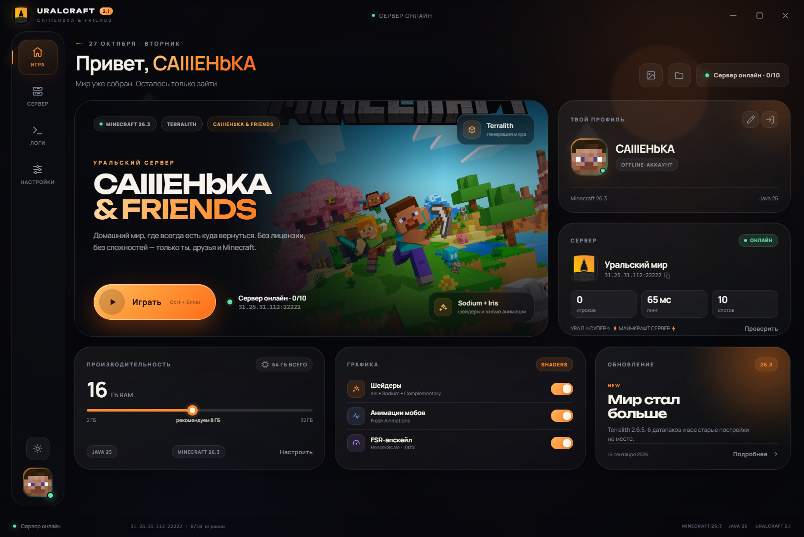
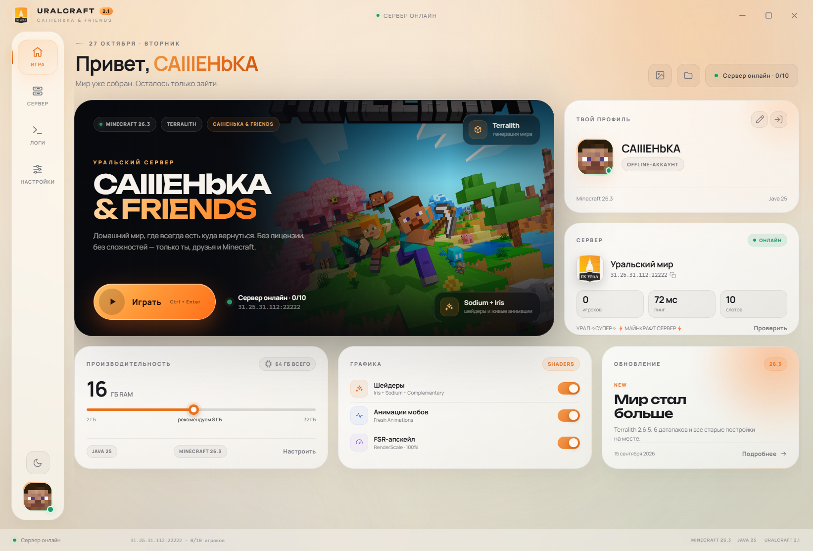
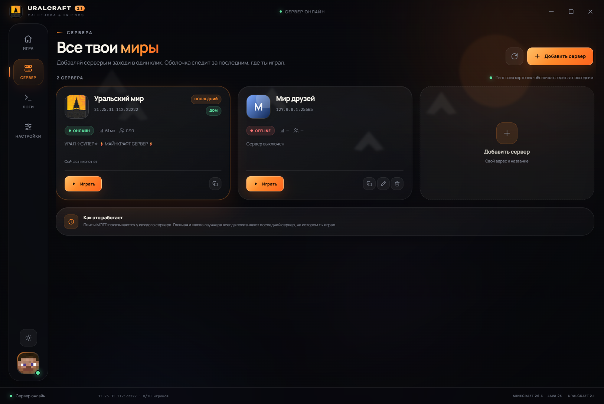
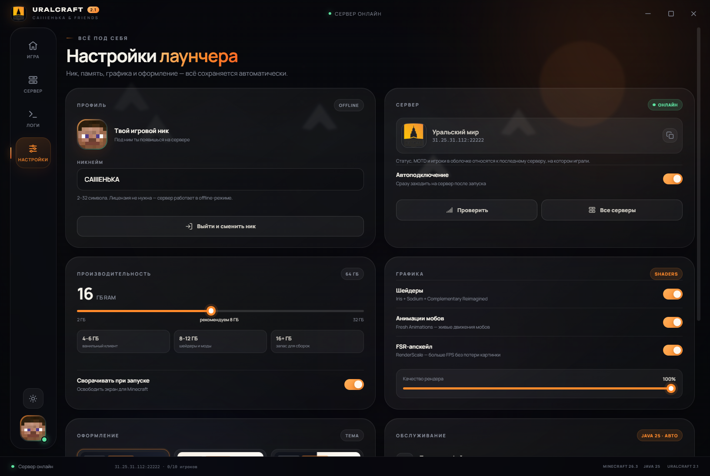
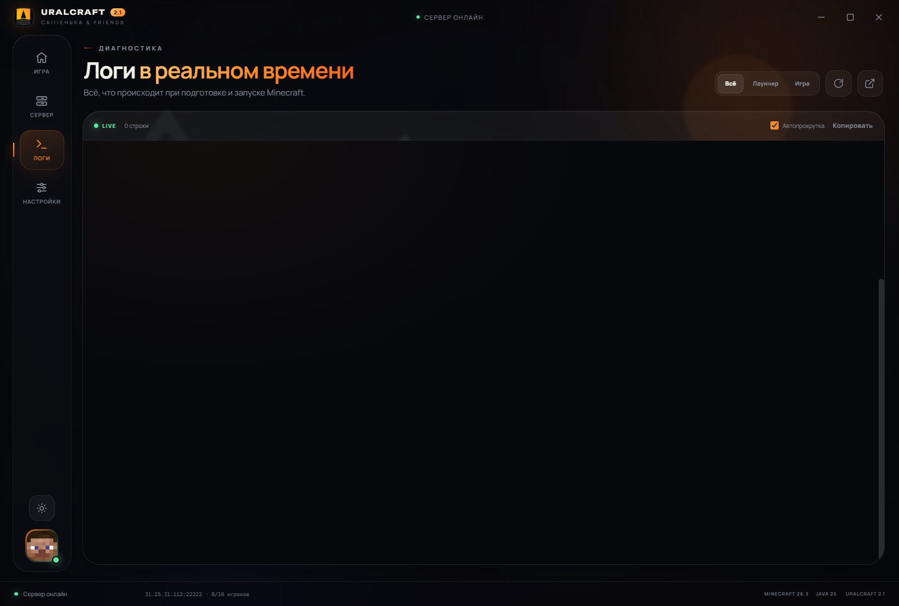
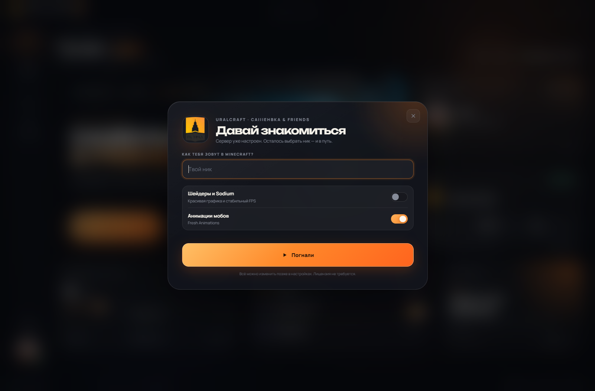

# URALCRAFT Launcher 2.2

Современный лаунчер Minecraft для сервера **CAIIIEHbKA & Friends**.  
Windows 10/11 x64 · Minecraft **26.3** · Fabric · Java 25 · шейдеры · offline-аккаунт.



## Что умеет

- Запускает **Minecraft 26.3** с сервера `31.25.31.112:22222`.
- Сам скачивает клиент Mojang, библиотеки, ресурсы и **Temurin JRE 25**.
- Поддерживает **Fabric + Sodium + Iris** и шейдерпак **Complementary Reimagined**.
- Включает **Fresh Animations**, FSR-апскейл **RenderScale** и последнюю
  совместимую release-версию **Simple Voice Chat** для Fabric.
- Вкладка **«Серверы»** — красивый список с добавлением, редактированием
  и удалением серверов. Домашний сервер всегда первый.
- Пингует **все карточки** серверов, а главная и шапка показывают последний
  сервер, на котором играли.
- Работает без лицензии — сервер в offline-режиме.
- Кнопка **«Выйти / сменить ник»** на главной и в настройках: настройки,
  серверы и файлы игры сохраняются.
- Хранит настройки, ник, RAM, тему и состояние окна.
- Умеет проверять и восстанавливать файлы, открывать папку игры и логи.
- Reuse-ит старую папку `%APPDATA%\.uralcraft`, поэтому у Саши не придётся
  заново качать клиент после перехода со старого Python-лаунчера.
- Спокойная тёмная тема: без движущейся «пелены» и дрейфующих слоёв.

## Скриншоты

| Тёмная тема | Светлая тема |
| --- | --- |
|  |  |



| Настройки | Логи |
| --- | --- |
|  |  |

<details>
<summary>Первый запуск</summary>



</details>

## Как поставить друзьям

1. Взять из папки `release/` один из файлов:
   - `URALCRAFT-Setup-2.2.0.exe` — обычный установщик;
   - `URALCRAFT-Portable-2.2.0.exe` — портативная версия без установки.
2. Запустить, ввести свой ник.
3. Нажать **«Погнали»** и дождаться первой загрузки.
4. Играть.

Домашний сервер уже создан и стоит первым в списке. Остальные серверы
добавляются на вкладке «Серверы».

> Первый запуск скачивает примерно **600–700 МБ**: клиент, библиотеки,
> ресурсы, Java и графические моды. Дальше загрузка занимает секунды.

Установщик не подписан сертификатом, поэтому Windows SmartScreen может
показать предупреждение. Это нормально для домашнего лаунчера: нажми
**«Подробнее» → «Выполнить всё равно»**.

Готовые файлы лежат в `release/`:

- `URALCRAFT-Setup-2.2.0.exe` — установщик;
- `URALCRAFT-Portable-2.2.0.exe` — портативная версия;
- `URALCRAFT-2.2.0-Windows.zip` — оба файла + короткая памятка.

## Что внутри

- **Electron 45** — оболочка приложения.
- **Нативный Node.js launcher core** — без сторонних «магических» библиотек:
  манифест Mojang, version JSON, rules, classpath, assets, natives, Java.
- **Fabric Loader** — последняя стабильная версия для 26.3 (0.20.1).
- **Modrinth API** — Fabric API, Sodium, Iris, Cloth Config, RenderScale,
  EMF, ETF, Simple Voice Chat, Complementary Reimagined, Fresh Animations.
- **Server List Ping** — честный статус каждого сервера в списке.
- **Offline-аккаунт** — сервер `online-mode=false`, используется offline UUID.
  Microsoft-вход сознательно отложен: сейчас не требуется.

## Проверено

- Чистая установка с нуля: клиент, библиотеки, 5147 ресурсов, Java 25,
  Fabric, моды, шейдерпак и анимации скачались без ошибок.
- Реальный запуск Minecraft 26.3: Fabric Loader, Sodium, Iris,
  Complementary Reimagined и Fresh Animations загрузились.
- Сквозной вход на локальный сервер 26.3:
  `CAIIIEHbKA joined the game`.
- Публичный сервер `31.25.31.112:22222` отвечает статусом (MOTD, пинг,
  список игроков).
- Упакованное приложение и портативная сборка запускаются.

## Настройки

| Параметр | Что делает |
| --- | --- |
| Ник | имя игрока в игре |
| Серверы | список серверов, добавление/редактирование/удаление |
| Автоподключение | сразу заходить на последний/выбранный сервер |
| RAM | память для Minecraft (рекомендация зависит от объёма ПК) |
| Шейдеры | Fabric + Iris + Sodium + Complementary |
| Анимации мобов | ресурспак Fresh Animations |
| Голосовой чат | последняя совместимая версия Simple Voice Chat для Fabric |
| FSR-апскейл | RenderScale, 50–100 % |
| Сворачивать при запуске | освобождает экран для игры |
| Тема | тёмная / светлая / системная |
| Проверка файлов | SHA1-проверка клиента, библиотек и ресурсов |

Логи и настройки можно открыть прямо из лаунчера.

## Разработка

Требуется Node.js 22+ и Windows.

```bash
npm install
npm start
```

Сборка:

```bash
npm run dist
```

Или только распакованная версия:

```bash
npm run pack
```

Проверка core-логики без запуска игры:

```bash
node scripts/verify-core.js
```

Для проверки «чистой» установки можно задать отдельную папку:

```powershell
$env:URALCRAFT_HOME = "$env:TEMP\uralcraft-test"
node scripts/verify-core.js
```

## Структура

```
src/
  main/
    main.js              окно, IPC, жизненный цикл
    preload.js           безопасный мост renderer ↔ main
    core/
      paths.js           пути, версия, константы
      config.js          настройки и миграция старого launcher.json
      servers.js         список серверов, last played, иконки
      version.js         Mojang manifest, client, libraries, assets, natives
      java.js            поиск/установка Temurin JRE
      fabric.js          Fabric Loader и merged profile
      mods.js            Modrinth, шейдеры, ресурспаки, options.txt
      ping.js            Server List Ping + MOTD
      launch.js          аргументы и spawn Minecraft
      engine.js          общий pipeline подготовки и запуска
      net.js             загрузки, SHA1, ретраи, прогресс
  renderer/
    index.html
    styles/app.css
    app.js
    assets/              подготовленные фоны, иконки, шрифты
scripts/
  verify-core.js
docs/                    скриншоты
build/                   иконка приложения
```

## Где лежат файлы игры

По умолчанию:

```
%APPDATA%\.uralcraft\
  game\          мир, моды, ресурспаки, настройки Minecraft
  versions\      клиент 26.3 и Fabric-профиль
  libraries\     библиотеки
  assets\        ресурсы Mojang
  jre-25\        Java 25
  logs\          launcher.log, java.log
  launcher.json  настройки
  servers.json   список серверов и последний сыгранный
```

Портативная версия использует ту же папку, поэтому друзья могут переносить
лаунчер без потери настроек.

## Сервер


- Версия: Minecraft **26.3**
- Мир: Terralith 2.6.5, старые постройки сохранены
- 6 датапаков, PvP включён, сложность normal
- `online-mode=false` — лицензия не нужна


---

Сделано для Сашеньки и его друзей.  
URALCRAFT 2.2 · 2026
